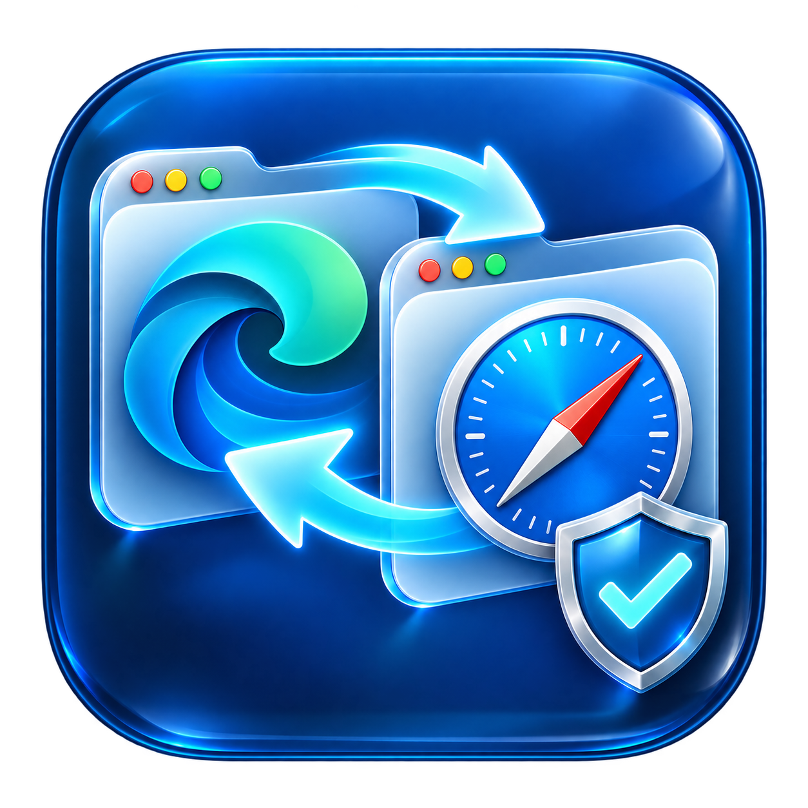

# Safari 收藏夹同步 · V0.9

简体中文 · [English](README.md)



原生 macOS 收藏夹工具，可选 **Edge → Safari** 或 **Safari → Edge**，两个方向都支持增量和纯镜像，每次写入前完整备份两边的收藏夹文件。

**当前状态：** V0.9 / `0.9.0` 首个公开预览版本。

## 功能

- 默认 Edge → Safari，也可选择 Safari → Edge。
- 增量合并和纯镜像，保留目录结构。
- 自动双边备份、独立手动备份、校验、恢复和移到废纸篓删除。
- 菜单栏快捷面板；图标被隐藏时，Dock 右键菜单仍可打开面板。
- 检查图标是否在屏幕外或被刘海遮挡，提供恢复入口。
- 中英文适配，支持跟随系统或手动选语言。
- 原生“同步、备份、设置”分组，深浅色外观、进度和完成/错误提示。
- 本机定时运行，无需账号、服务器或运行时 AI 服务。

## 要求与安装

Apple Silicon Mac、macOS 13 或以上，Microsoft Edge 正式版和 Safari 书签文件。写入前只需退出**目标浏览器**；自动任务遇到目标运行会跳过，不自动退出浏览器。

1. 从 [GitHub Releases](https://github.com/PlanetWorks42/safari-bookmark-sync/releases) 下载安装器，双击 `SafariBookmarkSync-0.9.0-arm64.pkg`，通过系统安装器安装到 `/Applications/Safari 收藏夹同步.app`。
2. 从“应用程序”打开，在“设置”选择 Edge 个人资料及 Safari 原始 `~/Library/Safari/Bookmarks.plist`。
3. 点击“检查访问”。若被拒绝，点击“打开完全磁盘访问设置”，添加并开启安装后的 App，按提示重新打开。
4. 先备份，再选择方向和模式，首次同步后核对目标浏览器。

本机预览 App 使用临时签名，安装包未经过 Developer ID 签名及 Apple 公证。安装权限不会自动变成 Safari 文件访问权限。

## 两种模式

| 模式 | 行为 |
| --- | --- |
| 增量 | 保留目标现有书签，合并同名目录，在同一目录按完整网址去重。 |
| 纯镜像 | 用来源目录、名称、顺序和重复条目替换目标普通书签；来源为空时停止。 |

Safari 阅读列表和系统代理节点不参与同步；恢复完整 Safari 文件会还原其备份时状态。iCloud / Edge 云同步可能传播、合并或覆盖本机变更，本应用不关闭云同步。浏览器内部格式可能变化，未知结构或校验不兼容时拒绝写入。

## 菜单栏与语言

关闭主窗口后，顶部循环箭头继续提供快捷操作。如果使用 Bartender，请将本应用从“始终隐藏”移到“显示”。“设置 → 菜单栏”会检查实际位置并提供恢复按钮；也可通过 Dock 右键 → 打开快捷面板。

“设置 → 通用 → 语言”可选择跟随系统、English、简体中文，重新打开生效。用户自己的个人资料名称和旧备份原因保留原始语言。

## 备份与隐私

本机目录：`~/Library/Application Support/SafariTabSync/FavoritesBackups/`。每份包括完整 Safari 文件、Edge 文件及校验清单。恢复前先备份当前数据；恢复双边备份需要退出两个浏览器。兼容旧版 Safari 单边备份。删除会移到废纸篓，不自动清理。

本应用不会上传书签、备份、日志或机器诊断。不要在公开问题中附上真实书签或未脱敏备份。

## 构建和检查

安装 Xcode Command Line Tools 后运行：

```sh
zsh build.sh
zsh test-favorites.sh
zsh package.sh
```

可选界面检查不会同步，也不会关闭浏览器：

```sh
SAFARI_SYNC_LANGUAGE=en SAFARI_SYNC_THEME=light \
  "dist/Safari 收藏夹同步.app/Contents/MacOS/SafariTabSync" --ui-smoke-test
SAFARI_SYNC_LANGUAGE=zh-Hans SAFARI_SYNC_THEME=dark \
  "dist/Safari 收藏夹同步.app/Contents/MacOS/SafariTabSync" --ui-smoke-test
```

测试使用模拟文件，覆盖两个方向、两种模式、备份恢复/回滚、资料保护、菜单栏位置和语言格式。另行检查 全部双语资源的完整性及参数占位。真实浏览器验收仍需要文件授权和手动核对，不把模拟测试通过当成对全部版本及云同步配置的兼容保证。

代码结构和英文介绍见 [English README](README.md)。[贡献说明](CONTRIBUTING.md) · [安全说明](SECURITY.md) · [更新日志](CHANGELOG.md) · [MIT 许可证](LICENSE)。本项目独立于 Apple 和 Microsoft；相关名称及商标归各自所有者。
